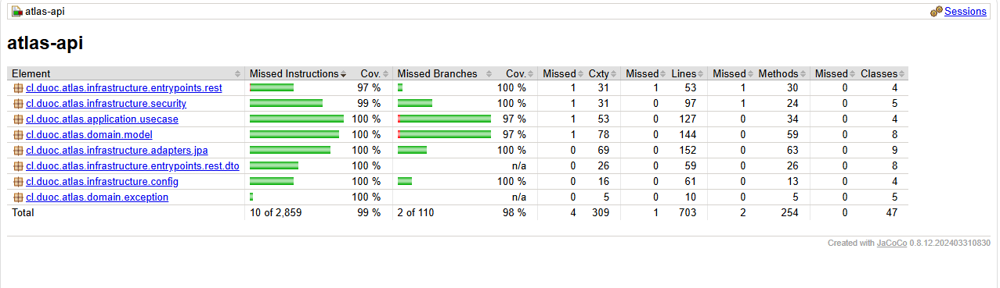

# Atlas — MVP Caso A (EP02 · ISY1102)

MVP de **Atlas**, la plataforma de CreaLab SpA descrita en el ERS del **Caso A**: gestión de
**clientes** y de sus **contratos**, con **login JWT** y **roles ADMIN / EDITOR**.

(Spring Boot + Maven + SQLite, arquitectura limpia y 14 herramientas de calidad y seguridad).

| Equipo | Rol en la EP02 |
| --- | --- |
| Felipe Bravo Aracena | Código, despliegue y pipeline → [`GUIA_DESPLIEGUE.md`](guias/GUIA_DESPLIEGUE.md) |
| Pablo Astroza Navarro | Pruebas y evidencias → [`GUIA_TESTER.md`](guias/GUIA_TESTER.md) |
| Yanfranco Cariqueo Donoso | Informe final → [`GUIA_INFORME.md`](guias/GUIA_INFORME.md) |

---

## 1. Qué es y por qué un MVP

El informe de la **EP01** planificó las pruebas del sistema completo (RF-1 a RF-6). Para la
**EP02** el equipo construyó y probó un **MVP**: los módulos que concentran el riesgo del
negocio (sesión, control de acceso, datos de clientes y contratos). Así se puede ejecutar el
plan de pruebas de verdad, con el pipeline del curso. El resto de los requisitos tienen
casos de prueba **diseñados** en el informe y quedan para las siguientes iteraciones.

> Cambio de tecnología respecto del EP01 (React + Node/Express + PostgreSQL): se adoptó el
> código base y el pipeline Maven entregados en el curso. PostgreSQL y el frontend siguen
> siendo el objetivo del producto completo.

## 2. Alcance

| Requisito del ERS | Estado | Cómo |
| --- | --- | --- |
| RF-1.1 Login con usuario y contraseña | ✅ | `POST /api/v1/auth/login` entrega un JWT de 15 min |
| RF-1.2 Cierre de sesión y revocación | ✅ | `POST /api/v1/auth/logout` invalida el token |
| RF-3.2, RB-4, RB-5 Roles (editor solo lectura) | ✅ | Spring Security: escritura solo ADMIN |
| RF-4.1, 4.2, 4.3 Clientes | ✅ | CRUD, filtro, paginación, RUT módulo 11, eliminación lógica con confirmación |
| RF-5.1, 5.4, RB-3 Contratos con estado | ✅ | ACTIVO / POR_VENCER (≤ 30 días) / EXPIRADO |
| RF-6.1 Auditoría | ◐ | Log `AUDITORIA` de acciones críticas, sin datos personales |
| NFR-SEG-2, 4, 5, 6, 9 | ✅ | bcrypt, roles, validaciones, cabeceras, errores seguros, JWT |
| NFR-PERF-1, NFR-PERF-3 | ✅ | p95 < 300 ms; 200 usuarios con JMeter |
| NFR-USAB-3, NFR-USAB-4 | ✅ | Errores en español; Swagger/Redoc; clientes → contratos |
| RF-2, RF-3.1, RF-3.3, RB-1, RB-2 (registro, empresas, usuarios) | ✗ | Fuera del MVP (casos diseñados) |
| RF-5.2, 5.3, 5.5 (documentos y enlaces) | ✗ | Fuera del MVP (CP-INT-01 diseñado) |
| NFR-SEG-1, 3, 7 (TLS, cifrado en reposo, respaldos) | ✗ | Se resuelven en el despliegue productivo |
| NFR-PERF-2, NFR-USAB-1/2, NFR-COMPAT (frontend) | ✗ | Sin frontend en esta entrega (CP-PERF-01, CP-USA-01 diseñados) |

## 3. Cómo ejecutarlo

Todos los comandos se ejecutan **dentro de la carpeta `atlas-ep2/`**:

```bash
cd atlas-ep2
```

### Opción A — Docker (no requiere Java)

```bash
cp .env.example .env          # Windows: copy .env.example .env
docker compose up --build     # primera vez: 3–5 minutos
```

### Opción B — Java 21 + Maven Wrapper

```bash
./mvnw spring-boot:run        # Windows: mvnw.cmd spring-boot:run
```

| Recurso | URL |
| --- | --- |
| Home | http://localhost:8080/ |
| Swagger UI | http://localhost:8080/swagger-ui.html |
| Redoc | http://localhost:8080/redoc.html |
| Contrato OpenAPI | http://localhost:8080/openapi/atlas-openapi.yaml |

| Usuario | Contraseña (demo) | Rol |
| --- | --- | --- |
| `admin` | `Admin#Atlas2026` | ADMIN |
| `editor` | `Editor#Atlas2026` | EDITOR |

La base SQLite (`atlas-ep2/data/atlas.db`) se crea al arrancar con 3 clientes y 3 contratos de ejemplo
(uno en cada estado). Las contraseñas se cambian con las variables de `.env`.

## 4. Arquitectura

```
cl.duoc.atlas
├── domain           modelos (Cliente, Contrato, Usuario), reglas (EstadoContrato, Rut), puertos y excepciones
├── application      casos de uso: ClienteUseCase, ContratoUseCase, AuthUseCase
└── infrastructure   adapters/jpa (SQLite) · security (JWT, roles) · entrypoints/rest · config
```

Recorrido de una petición: `SecurityHeadersFilter` (cabeceras) → `JwtAuthFilter` (valida el
token) → `SecurityConfig` (permiso por rol) → controlador (valida el JSON) → caso de uso
(reglas + auditoría) → gateway JPA → `ApiExceptionHandler` (errores claros).

54 clases de código y 26 de pruebas.

## 5. Validaciones que cubre el código

### 5.1 Pipeline `.github/workflows/calidad-codigo.yml` (14 jobs encadenados)

El workflow está en la raíz del repo y ejecuta cada job dentro de `atlas-ep2/`. Los comandos locales se corren desde esa carpeta.

| # | Job | Qué valida | Comando local | Último resultado |
| --- | --- | --- | --- | --- |
| 1 | Spotless | Formato del código | `./mvnw spotless:check` | 0 problemas |
| 2 | Checkstyle | Convenciones | `./mvnw checkstyle:check` | 0 violaciones |
| 3 | PMD | Code smells | `./mvnw pmd:check` | 0 violaciones |
| 4 | SpotBugs | Bugs en bytecode | `./mvnw compile spotbugs:check` | 0 bugs |
| 5 | JUnit + Mockito | Reglas, seguridad, integración | `./mvnw test` | 152 pruebas, 0 fallas |
| 6 | PIT | Fuerza de las pruebas (mutación ≥ 80 %) | `./mvnw test-compile org.pitest:pitest-maven:mutationCoverage` | 96,6 % |
| 7 | JaCoCo | Cobertura (≥ 80 %) | `./mvnw verify` | 99,9 % líneas |
| 8 | SonarQube | Quality Gate | `./mvnw sonar:sonar` | Requiere token |
| 9 | Snyk | Dependencias vulnerables | `snyk test --severity-threshold=critical` | Requiere token |
| 10 | Cucumber | Escenarios de negocio (Gherkin) | `./mvnw test -Dtest=CucumberRunnerTest` | 11 escenarios OK |
| 11 | Docker + Trivy | CVE del SO de la imagen | `docker build` + `trivy image` | 0 HIGH/CRITICAL |
| 12 | OWASP ZAP | DAST: cabeceras y configuración | `zap-baseline.py` | 0 FAIL |
| 13 | Gatling | p95 < 300 ms, 0 errores | `./mvnw gatling:test` | p95 6 ms |
| 14 | JMeter | Carga con usuarios concurrentes | `./mvnw -Pjmeter …` (ver guía) | 0 % error |

Los jobs 1–7 se ejecutan juntos con `./mvnw clean verify`. Los jobs 12–14 necesitan la app levantada.

### Cobertura de pruebas (JaCoCo)



> 152 pruebas · 99 % instrucciones · 98 % ramas · 702/703 líneas · mutación PIT 97 % (umbral 80 %).

### 5.2 Controles de seguridad implementados

| Control | Dónde | Requisito |
| --- | --- | --- |
| Contraseñas con bcrypt (costo 12) | `SecurityConfig` | NFR-SEG-2 |
| JWT HS256 de 15 min con `jti` y revocación en logout | `JwtService` | RF-1, NFR-SEG-9 |
| Bloqueo 15 min tras 5 intentos fallidos; mismo mensaje si el usuario no existe | `AuthUseCase` | OWASP A07 |
| Lectura ADMIN/EDITOR, escritura solo ADMIN | `SecurityConfig` | NFR-SEG-4, RB-4, RB-5 |
| Validación de RUT, correo, teléfono y rechazo de `<` `>` | DTOs `*Request`, `Rut` | NFR-SEG-5, RF-4.3 |
| Consultas parametrizadas | Spring Data JPA | Inyección SQL |
| CSP, X-Frame-Options, nosniff, Referrer-Policy (también en 401/403) | `SecurityHeadersFilter` | XSS, clickjacking |
| Errores sin trazas ni detalles internos | `ApiExceptionHandler` | NFR-SEG-6 |
| Auditoría sin datos personales y con saneamiento de saltos de línea | Casos de uso | RF-6.1, CWE-117 |
| Imagen Docker sin root, parches del SO | `Dockerfile` | Contenedores |
| Dependencias actualizadas (Spring Boot 3.5.16, Tomcat 10.1.61, Jackson 2.21.7) | `pom.xml` | OWASP A06 |

### 5.3 Pruebas manuales (Postman, ZAP, JMeter)

`atlas-ep2/postman/Atlas.postman_collection.json` tiene 42 requests y 82 aserciones; cada request lleva
el ID del caso del informe. El paso a paso para ejecutar y capturar está en
[`GUIA_TESTER.md`](guias/GUIA_TESTER.md).

### 5.4 Convención de IDs (la misma del EP01)

`CP-[FUN|INT|SEG|PERF|USA|CAL|NOR]-NN`. Los 6 casos del EP01 conservan su ID y significado:
CP-FUN-01 (eliminación lógica), CP-FUN-02 (estado del contrato), CP-INT-01 (documento +
auditoría, diseñado), CP-SEG-01 (editor sin escritura), CP-PERF-01 (carga móvil, diseñado) y
CP-USA-01 (adultos mayores, diseñado). Se agregan CAL (calidad del código) y NOR (normativa).

## 6. Endpoints

| Método | Ruta | Rol |
| --- | --- | --- |
| POST | `/api/v1/auth/login` | Público |
| POST | `/api/v1/auth/logout` | Autenticado |
| GET | `/api/v1/clientes?nombre=&pagina=0&tamano=10` | ADMIN, EDITOR |
| GET | `/api/v1/clientes/{id}` | ADMIN, EDITOR |
| POST / PUT | `/api/v1/clientes`, `/api/v1/clientes/{id}` | ADMIN |
| DELETE | `/api/v1/clientes/{id}?confirmar=true` | ADMIN |
| GET / POST | `/api/v1/clientes/{id}/contratos` | GET: ADMIN, EDITOR · POST: ADMIN |
| GET / PUT / DELETE | `/api/v1/contratos/{id}` | GET: ADMIN, EDITOR · PUT/DELETE: ADMIN |

## 7. Limitaciones conocidas y trabajo futuro

- Sin frontend, documentos, registro de empresas ni multiempresa en esta entrega.
- Lista de revocación y contador de intentos en memoria (se pierden al reiniciar).
- Con 200 usuarios iniciando sesión en 20 s, bcrypt satura la CPU (incidente de rendimiento).
- 2 CVE críticos residuales en `spring-webmvc` que solo se corrigen con Spring Boot 4.
- Swagger UI incluye una versión de DOMPurify reportada por ZAP; deshabilitar Swagger en producción.

## 8. Estructura del repositorio

```
.
├── README.md                       este documento
├── .github/workflows/calidad-codigo.yml   pipeline de 14 jobs (trabaja en atlas-ep2/)
├── atlas-ep2/                      aplicativo
│   ├── src/main/java …             código (arquitectura limpia)
│   ├── src/main/resources/static   Home, Redoc, contrato OpenAPI
│   ├── src/test/java …             JUnit, Mockito, integración, Cucumber, Gatling
│   ├── src/test/resources/features escenarios Gherkin en español
│   ├── src/test/jmeter/atlas.jmx   plan de carga JMeter
│   ├── postman/                    colección y entorno
│   ├── scripts/ci-resumen.sh       resúmenes del pipeline
│   ├── Dockerfile · docker-compose.yml · .env.example
│   ├── pom.xml · mvnw · mvnw.cmd · .mvn/
│   └── checkstyle.xml · pmd-ruleset.xml · spotbugs-exclude.xml · .zap/ · .snyk · sonar-project.properties
├── evidencias/                     capturas de la EP02 (00-despliegue … 06-pipeline) y RESULTADOS.md
└── guias/                          GUIA_DESPLIEGUE (Felipe) · GUIA_TESTER (Pablo) · GUIA_INFORME (Yanfranco)
```

## 9. Credenciales del pipeline (SonarCloud y Snyk)

Repo → **Settings → Secrets and variables → Actions**. Sin ellas, los jobs 8 y 9 terminan en
verde con el aviso "pendiente".

| Tipo | Nombre | Valor |
| --- | --- | --- |
| Secret | `SONAR_TOKEN` | Token de SonarCloud (My Account → Security) |
| Secret | `SONAR_HOST_URL` | `https://sonarcloud.io` |
| Secret | `SNYK_TOKEN` | Auth Token de Snyk (Account settings) |
| Variable | `SONAR_ORGANIZATION` | Organization key de SonarCloud |
| Variable | `SONAR_PROJECT_KEY` | Project key de SonarCloud (ej. `usuario_atlas-ep02`) |

En SonarCloud desactivar **Administration → Analysis Method → Automatic Analysis**. Detalle en
[`guias/GUIA_DESPLIEGUE.md`](guias/GUIA_DESPLIEGUE.md).
